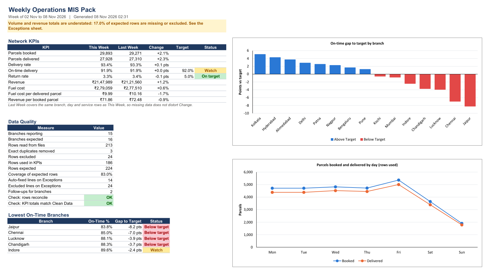
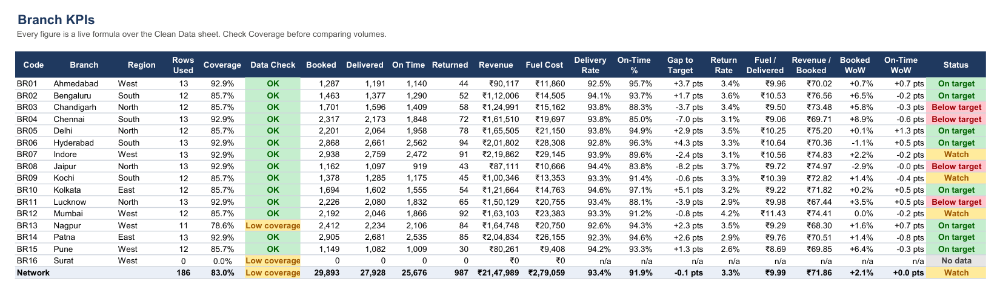
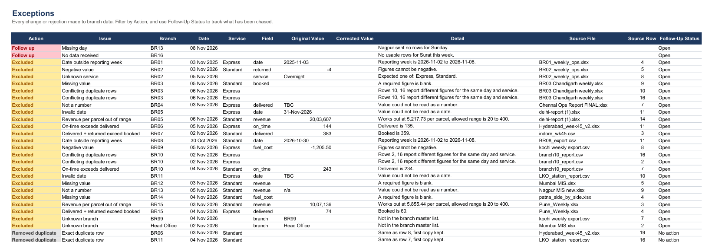

# Automated Weekly Operations MIS Pack
**Python · pandas · openpyxl · Excel**   |   Author: [Ahmed Arshad](https://github.com/ahamed-arshad)


> **Brief:** *A team spends 4 hours every Monday merging branch Excel files into one report. Automate it.*

I built this around a made-up courier company with 16 branches across India. Each branch
sends its weekly numbers in its own format, with its own mistakes. The script reads all the
files, cleans and checks the data, calculates the KPIs, and writes a formatted Excel report
with an exceptions sheet.

All the data is synthetic.

---

## Results

| | |
|---|---|
| **Run time** | About 1 second for 15 files and 213 rows, against 4 hours by hand |
| **Estimated saving** | 3.5 hours a week, about 182 hours a year ([how I got this](docs/time_saved.md)) |
| **Input formats handled** | 6 layouts across `.xlsx` and `.csv` |
| **Data problems found** | 14 lines auto-fixed, 3 duplicates removed, 24 rows excluded, 2 branch follow-ups |
| **Accuracy check** | All 37 planted issues caught, and every kept row matches the original data |
| **Sample week** | 29,893 parcels booked, 91.9% on time against a 92% target |

**Download the sample report: [MIS_Pack_2026-11-02.xlsx](output/MIS_Pack_2026-11-02.xlsx)**



---

## How it works

```
branch files  ->  find header  ->  map columns  ->  validate rows  ->  Excel report
(6 layouts)       (skip titles)    (to 9 fields)    (fix / exclude)    (live formulas)
```

**1. Read any layout.** The sample files include title rows above the table, totals rows
below it, data hidden behind a cover sheet, semicolon CSVs, and one file with Express and
Standard side by side in the same row. The script searches each file for its header row
and matches the headings against a list of known names, so a renamed column is a one-line
change in [config.py](config.py).

**2. Treat errors by risk.** I only auto-fix a value when there is one possible right
answer. Anything that needs a judgement call stays out of the KPIs until a person looks at it.

| Action | Examples |
|---|---|
| Auto-fixed | `  DELHI ` to Delhi, `Chenai` to Chennai, `₹1,368.75` to 1368.75, `EXP.` to Express |
| Removed duplicate | The same row sent twice (first copy kept) |
| Excluded | Blank figures, negative values, on-time above delivered, dates outside the week, unknown branches, revenue entered 100x too high |
| Follow up | A branch that sent nothing, a whole day missing, a file that won't open |

**3. Write a report people can check.** KPI cells are live Excel formulas over the Clean
Data sheet, using named ranges like `=SUMIFS(cd_booked,cd_branch,$A5)`, so anyone can click
a number and see where it came from. Each clean row also records its source file and row.



Every fix and rejection goes on the Exceptions sheet, with a dropdown for tracking follow-ups.



---

## Decisions worth explaining

**Ambiguous dates.** `03/11/2026` could be 3 November or 11 March, and some branches use
each format. Guessing row by row would silently put data in the wrong month, so the script
checks which reading puts the whole file inside the reporting week and uses that one.

**Fair week-on-week numbers.** A missing row would look like a drop in volume. So Change
only compares the branch, day and service rows that exist in both weeks.

**Being open about gaps.** 17% of the expected rows are missing or excluded in the sample
week, so the Summary sheet says totals are understated instead of leaving people to find out.

**Rates built from totals.** The network on-time figure is total on-time divided by total
delivered, not an average of branch percentages, so small branches don't skew it.

---

## How I tested it

The data generator saves a list of every problem it plants, plus the original clean values.
That let me test against known answers instead of checking by eye. The 22 tests confirm that:

- All 37 planted issues are caught with the right outcome, with no false alarms
- Every kept row matches the original exactly, so fixes are correct and dates aren't misread
- A corrupt file or a missing column is reported without stopping the run
- Re-running a week replaces its history instead of doubling it
- The Excel formula results match a separate pandas calculation

The Summary sheet also has two live checks: rows read reconcile to rows used, and KPI
totals match Clean Data.

---

## Run it yourself

```bash
pip install -r requirements.txt
python mis_pack.py --week-start 2026-11-02
python -m pytest tests -q
```

To rebuild the sample data, run `python generate_branch_files.py`. Without `--week-start`,
the script reports on the last complete Monday to Sunday week, so it can be scheduled to
run every Monday. Branch files go in `data/input/<week-start>/`.

Open the report in Excel to see the KPI values. Excel calculates the formulas on opening,
so a file previewer shows those cells blank until the file has been saved from Excel.

## Project structure

```
├── mis_pack.py                 # main script: read, clean, validate
├── report_writer.py            # builds the Excel report
├── config.py                   # column names, rules and thresholds
├── generate_branch_files.py    # creates the synthetic data
├── data/
│   ├── input/                  # branch files for each week
│   ├── reference/              # branch list and planted-error answer key
│   └── history/                # clean rows used for week-on-week
├── output/                     # finished reports
├── tests/
├── docs/time_saved.md
└── images/
```

## Limits

- The rules are tuned on synthetic data. Real files would need new heading names and a
  review of the thresholds.
- Excluded rows stay out of the KPIs until the branch corrects its file and the pack is re-run.
- Money uses your computer's digit grouping, so the same value shows as ₹2,84,469 or
  ₹284,469 depending on Windows region settings.
